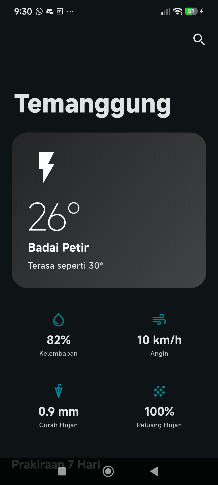
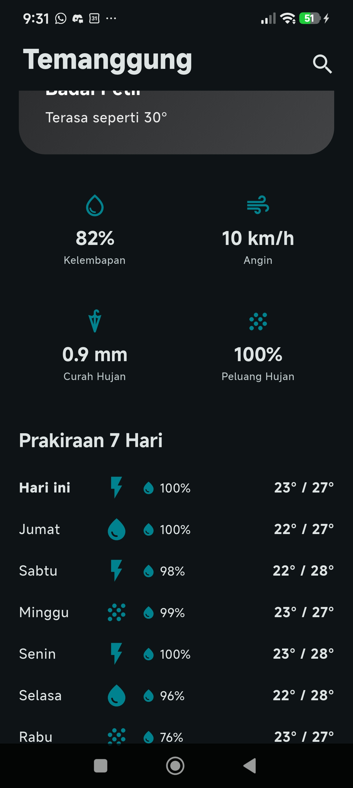
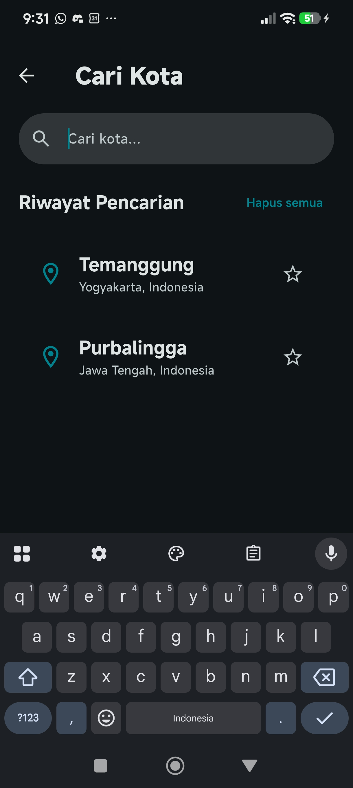

# Cuaca App

Aplikasi cuaca Android yang dibuat dengan Flutter dan Dart sebagai tugas Responsi Flutter. Data cuaca diambil langsung dari Open-Meteo REST API, dan pengguna dapat mencari kota, melihat prakiraan cuaca, serta menyimpan lokasi favorit.

## Fitur

- Menampilkan nama kota yang sedang dipilih
- Menampilkan kondisi cuaca terkini dan suhu saat ini
- Menampilkan suhu yang dirasakan, kelembapan udara, kecepatan angin, curah hujan, dan peluang hujan
- Menampilkan prakiraan cuaca 7 hari ke depan
- Pencarian kota berdasarkan nama (request langsung ke Geocoding API)
- Menyimpan lokasi favorit
- Menyimpan riwayat pencarian
- Mengingat lokasi terakhir yang dipilih saat aplikasi dibuka kembali
- Penanganan kondisi loading, data kosong, dan error
- Tema terang dan gelap mengikuti pengaturan sistem
- Pull to refresh pada halaman utama

## Teknologi

| Komponen | Keterangan |
|---|---|
| Framework | Flutter (Dart) |
| Platform | Android |
| UI | Material Design 3 dengan Theme terpusat |
| State management | Provider (ChangeNotifier) |
| Networking | package `http` (method GET) |
| Local storage | shared_preferences |
| Arsitektur | MVVM |
| API | Open-Meteo (Forecast API dan Geocoding API) |

## Struktur Folder

```
lib/
  main.dart
  models/
    location.dart
    weather.dart
  services/
    weather_service.dart
    storage_service.dart
  viewmodels/
    weather_viewmodel.dart
    search_viewmodel.dart
  views/
    home_screen.dart
    search_screen.dart
  widgets/
    (komponen UI yang dapat dipakai ulang)
  theme/
    app_theme.dart
  utils/
    weather_code.dart
```

Keterangan singkat:

- `models`: kelas data (Location, CurrentWeather, DailyForecast, WeatherData) beserta konversi dari dan ke JSON.
- `services`: pengambilan data dari API (`weather_service.dart`) dan penyimpanan lokal (`storage_service.dart`).
- `viewmodels`: logika aplikasi dan state yang diamati oleh tampilan.
- `views`: dua screen utama, yaitu Home dan Search.
- `widgets`: komponen tampilan yang dipakai ulang, seperti kartu cuaca, tile informasi, dan tile lokasi.
- `theme`: pengaturan tema warna, tipografi, dan bentuk komponen.
- `utils`: pemetaan kode cuaca (WMO weather code) menjadi deskripsi dan ikon.

## Penerapan MVVM

Aplikasi menggunakan pola Model-View-ViewModel dengan alur berikut:

```
View  ->  ViewModel  ->  Service  ->  API / Local Storage
                |
              Model
```

- **Model** menyimpan struktur data dan mengubah JSON dari API menjadi objek Dart.
- **View** hanya bertugas menampilkan UI dan meneruskan aksi pengguna ke ViewModel. View tidak memanggil API secara langsung.
- **ViewModel** (`WeatherViewModel` dan `SearchViewModel`) memegang state (loading, success, empty, error), memanggil Service, lalu memberi tahu View lewat `notifyListeners()`.
- **Service** berisi proses request HTTP ke Open-Meteo dan pembacaan atau penulisan data lokal.

View membaca state melalui Provider (`Consumer` atau `context.watch`), sehingga tampilan otomatis diperbarui ketika data berubah.

## Implementasi API

Aplikasi menggunakan dua endpoint Open-Meteo dengan method GET. Respons JSON diubah menjadi model Dart.

### 1. Geocoding API (pencarian kota)

```
GET https://geocoding-api.open-meteo.com/v1/search
```

| Parameter | Nilai |
|---|---|
| name | nama kota yang dicari |
| count | 10 |
| language | id |

### 2. Forecast API (data cuaca)

```
GET https://api.open-meteo.com/v1/forecast
```

| Parameter | Nilai |
|---|---|
| latitude | lintang lokasi terpilih |
| longitude | bujur lokasi terpilih |
| current | temperature_2m, relative_humidity_2m, apparent_temperature, precipitation, weather_code, wind_speed_10m |
| daily | weather_code, temperature_2m_max, temperature_2m_min, precipitation_probability_max |
| timezone | auto |
| forecast_days | 7 |

### Penanganan kondisi

- **Loading**: indikator progres ditampilkan selama request berjalan.
- **Data kosong**: pesan "Kota tidak ditemukan" ditampilkan jika pencarian tidak menghasilkan data.
- **Error**: pesan kesalahan dan tombol "Coba lagi" ditampilkan jika request gagal atau koneksi bermasalah.

## Local Storage

Data disimpan menggunakan `shared_preferences` dalam format JSON string:

- Daftar lokasi favorit
- Riwayat pencarian (maksimal 10 item, tanpa duplikat)
- Lokasi terakhir yang dipilih

Data tersebut dibaca kembali ketika aplikasi dibuka.

## Screenshot

### Home Screen




### Search Screen



## Video Penjelasan

Link video penjelasan kode: (isi dengan link video)

## Cara Menjalankan

Prasyarat: Flutter SDK terpasang dan perangkat Android atau emulator tersedia.

```
git clone (isi dengan link repository)
cd cuaca_app
flutter pub get
flutter run
```

Untuk membuat APK release:

```
flutter build apk --release
```

## Identitas

- Nama: (isi nama)
- NIM: (isi NIM)
- Mata kuliah: (isi mata kuliah)
